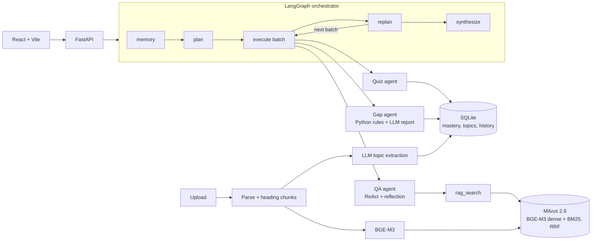

# SecondBrain

A study assistant built on your own notes. Upload notes, then ask questions, take quizzes, and get a report on your weak topics.

The repository also contains the evaluation pipeline (`backend/evaluation/`) and reports (`docs/`).

## Features

| Feature | What it does |
| --- | --- |
| Question answering | Answers from your notes and cites chunk ids. If the notes do not have the answer, the reply first says so (`笔记里没有找到相关内容。`), then answers from model knowledge. |
| Quiz | Generates multiple-choice questions from your notes and weak topics. Each answer updates your mastery score, which decays over time. |
| Gap diagnosis | Sorts every topic in your notes into 4 levels: unseen, weak, needs review, mastered. Python rules do the sorting; the LLM only writes the report. |
| Ingestion | Parses PDF, Word, and Markdown, chunks by heading, writes vectors to Milvus, and extracts topics with the LLM. |
| Conversation memory | Keeps recent rounds in SQLite and moves older rounds into a Milvus memory collection. |

## Architecture



- The planner turns one request into 1 or more steps. Steps without dependencies run at the same time. The replan step decides whether to continue, revise the plan, or stop (at most 3 times).
- Each chunk carries its heading path (for example `Data structures/Hash tables`). The heading path goes into both the embedding input and the BM25 text.
- Retrieval takes 15 candidates from dense search and 15 from BM25, fuses them with Reciprocal Rank Fusion (k = 60), and keeps the top 5. A BGE reranker is available but off by default.

## Tech stack

| Layer | Technology |
| --- | --- |
| Frontend | React 19, Vite, TypeScript, Tailwind CSS v4 |
| Backend | FastAPI, LangGraph, Python 3.11 |
| LLM | Any OpenAI-compatible API |
| Embedding | BAAI/bge-m3, 1024 dimensions, Chinese and English |
| Vector store | Milvus 2.6: HNSW dense index + built-in BM25 (jieba analyzer) |
| Database | SQLite (aiosqlite + SQLAlchemy async, WAL mode) |
| PDF parsing | magic-pdf (MinerU) |
| Evaluation | RAGAS, LLM judge (Claude Haiku 5.5 via OpenRouter), paired bootstrap |
| Tracing | Langfuse (optional) |
| Deployment | Docker Compose (Milvus, etcd, MinIO, backend) |

## Quick start

### Prerequisites

- Docker and Docker Compose
- Node.js 18+ for the frontend
- The model files under `backend/models/`

### 1. Create `backend/.env`

```env
# App LLM: any OpenAI-compatible endpoint
LLM_API_KEY=your-key
LLM_BASE_URL=https://your-openai-compatible-endpoint/v1
LLM_MODEL=your-model

EMBEDDING_MODEL_PATH=./models/bge-m3
RERANKER_MODEL_PATH=./models/bge-reranker-v2-m3
ENABLE_RERANKER=false
CITATION_MODE=fallback

MILVUS_HOST=milvus
MILVUS_PORT=19530
SQLITE_DB_PATH=./data/secondbrain.db

APP_ENV=development
```

For evaluation, also set the judge model:

```env
JUDGE_API_KEY=your-openrouter-key
JUDGE_BASE_URL=https://openrouter.ai/api/v1
JUDGE_MODEL=anthropic/claude-haiku-5.5
```

### 2. Download the models

```bash
pip install huggingface_hub
python -c "
from huggingface_hub import snapshot_download
snapshot_download('BAAI/bge-m3', local_dir='backend/models/bge-m3')
snapshot_download('BAAI/bge-reranker-v2-m3', local_dir='backend/models/bge-reranker-v2-m3')
"
```

### 3. Start the backend with Docker Compose

```bash
docker compose --profile backend up -d
docker compose logs -f backend
```

- Backend API: `http://localhost:18080`
- API docs: `http://localhost:18080/docs`
- Health check: `http://localhost:18080/health`

### 4. Start the frontend

```bash
cd frontend
npm install
npm run dev
```

Open `http://localhost:5173`. The Vite proxy sends `/api` requests to `localhost:18080`.

## Local development without Docker

1. Start Milvus only:

   ```bash
   docker compose up -d etcd minio milvus
   ```

2. Start the backend (set `MILVUS_HOST=localhost` in `backend/.env`):

   ```bash
   cd backend
   pip install -r requirements.txt
   uvicorn app.main:app --host 0.0.0.0 --port 8000 --reload
   ```

3. Start the frontend against the local backend:

   ```bash
   cd frontend
   VITE_PROXY_TARGET=http://localhost:8000 npm run dev
   ```

4. Run the unit tests:

   ```bash
   cd backend
   python -m pytest -q
   ```

## Run the evaluation

Run these from `backend/`, with Milvus running. Write every setting in the command so each run is reproducible.

```bash
# RAG on the L0 question set
MILVUS_HOST=localhost MILVUS_COLLECTION_NAME=secondbrain_docs \
ENABLE_RERANKER=false RERANKER_USE_HEADING=false CITATION_MODE=fallback \
python -m evaluation.eval_rag --profile full --dataset qa_l0_v1.json

# All notes in the prompt, no retrieval
MILVUS_HOST=localhost MILVUS_COLLECTION_NAME=secondbrain_docs \
ENABLE_RERANKER=false RERANKER_USE_HEADING=false CITATION_MODE=off \
python -m evaluation.eval_rag --profile full --dataset qa_l0_v1.json --mode longctx --longctx-corpus l0

# Paired comparison of two sets of runs
PYTHONPATH=. python -m evaluation.stats --a A r1.json r2.json r3.json --b B r4.json r5.json r6.json
```

Results go to `backend/evaluation/results/`. Each result file records the commit, whether the tree was dirty, the models, and the question set hash.

## API endpoints

| Method | Path | Description |
| --- | --- | --- |
| `POST` | `/api/chat/` | Chat entry for questions, quizzes, and gap diagnosis |
| `POST` | `/api/chat/stream` | Streaming chat |
| `GET` | `/api/chat/history` | Conversation history |
| `POST` | `/api/quiz/answer` | Submit a quiz answer and update mastery |
| `POST` | `/api/gap/analyze` | Run gap diagnosis directly |
| `POST` | `/api/ingest/upload` | Upload and ingest documents |
| `GET` | `/api/ingest/documents` | List documents |
| `DELETE` | `/api/ingest/documents/{filename}` | Delete a document and its index data |
| `GET` | `/health` | Health check |

## Troubleshooting

- The backend container does not start: run `docker compose logs -f backend` and check that `backend/models/` has both BGE models.
- The local backend cannot reach Milvus: set `MILVUS_HOST=localhost`.
- Upgrading from the Milvus 2.4 setup: the compose file uses new volumes (`*_v26`), so old data is not reused. Upload your documents again. Remove the old volumes with `docker volume rm` when you no longer need them.
- The frontend cannot reach the API: check that `VITE_PROXY_TARGET` points to the port the backend uses.
- The first request is slow: the embedding model loads on the first call, which takes longer on CPU.
